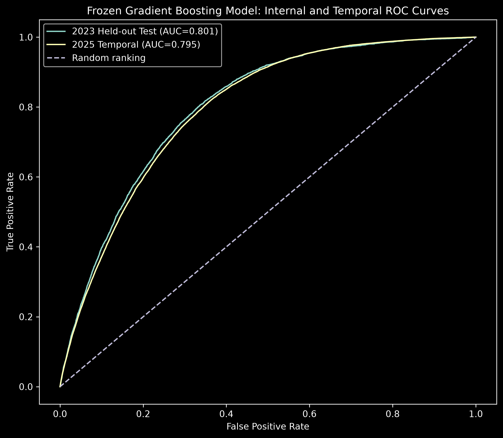
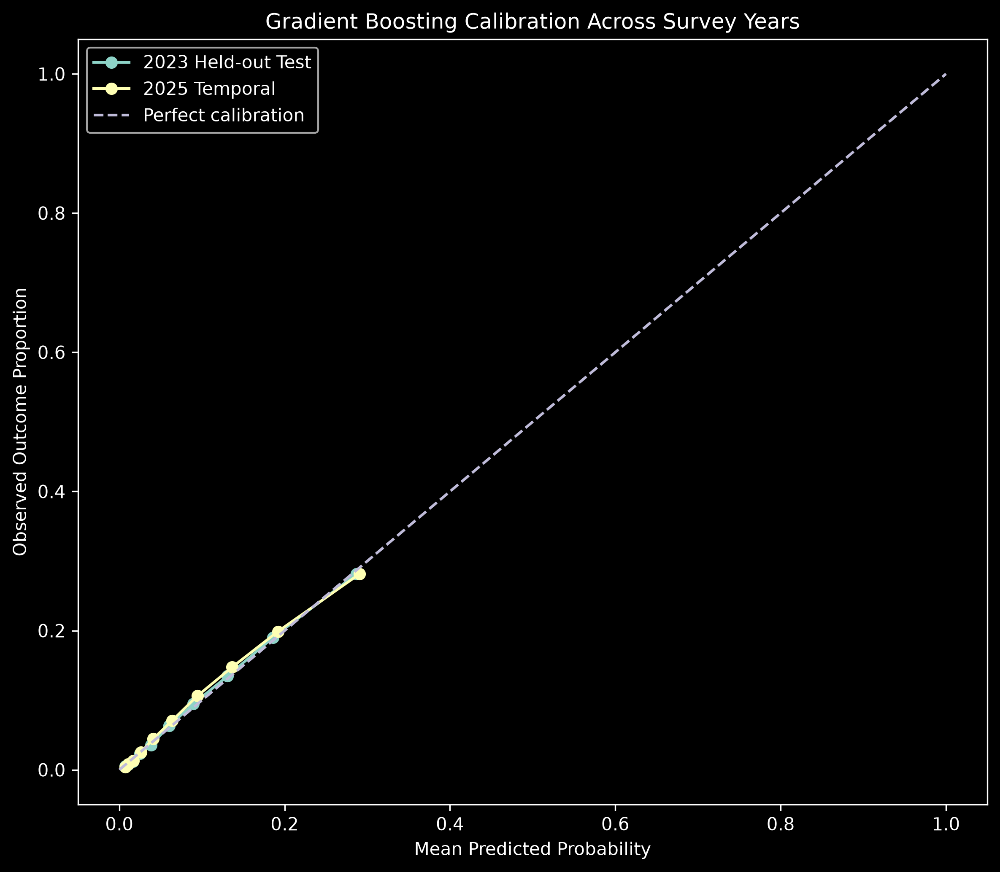
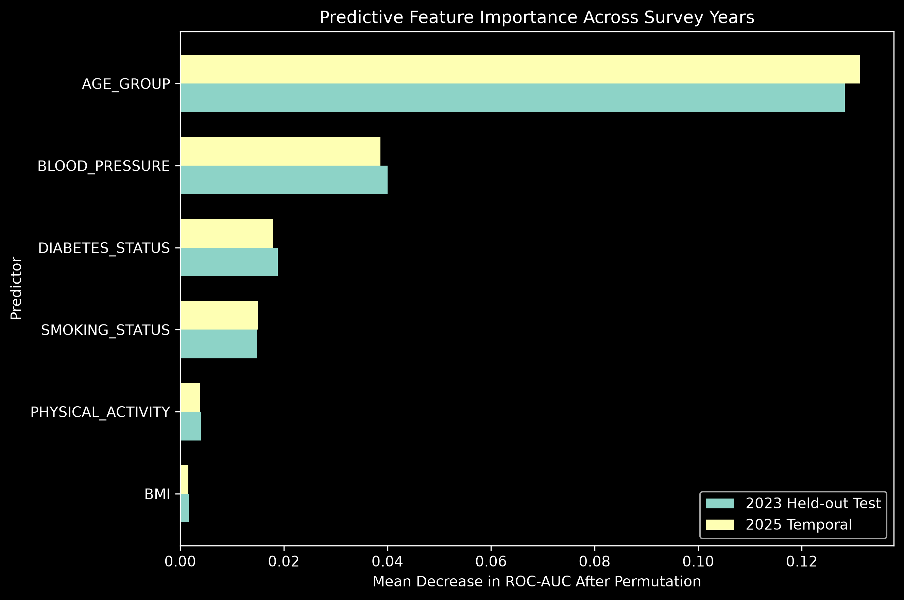

# Cardiovascular Machine Learning Research: BRFSS-Based Classification of Prevalent Self-Reported Myocardial Infarction and Coronary Heart Disease with Temporal Validation

**Research code and results · BRFSS 2023 development → BRFSS 2025 temporal evaluation**

**Status:** Phase 1 experimental baseline completed and released as `v0.1.0`; Phase 2 targeted critical literature review and research positioning completed (not a systematic review); Phase 3 data provenance audit and first full scientific manuscript draft completed (1 November 2026). Phase 4 scientific and reproducibility review is next. **No formal `v1.0.0` release or publication DOI has been issued.**

A reproducible Python study of **prevalent self-reported myocardial infarction (MI) and/or coronary heart disease (CHD)** in the U.S. Behavioral Risk Factor Surveillance System (BRFSS). The study compares classifiers, evaluates a 2023 held-out test set, and applies a **frozen 2023 model** to a separately collected BRFSS 2025 sample.

> **Scope:** Cross-sectional *classification of reported history*—**not** prediction of future cardiovascular events, clinical diagnosis, causal inference or prospective follow-up.

**Research repository:** [imksav/cardiovascular-ml-research](https://github.com/imksav/cardiovascular-ml-research)

**Permanent Phase 1 release:** [v0.1.0 — Completed Experimental Analysis](https://github.com/imksav/cardiovascular-ml-research/releases/tag/v0.1.0)

---

## Research Design

| Component | Implementation |
|---|---|
| Primary outcome | `_MICHD`, recoded to binary reported MI/CHD status |
| Development survey | BRFSS **2023**: 433,323 raw records; 428,738 known outcomes |
| Temporal evaluation | BRFSS **2025**: 356,158 raw records; 352,145 known outcomes |
| 2024 assessment | Compatibility assessment only; required `BPHIGH6` field unavailable in the local dataset |
| Predictors (6) | Age group, physical activity, smoking status, blood-pressure status, diabetes status, BMI |
| Internal split | 70% train / 15% validation / 15% locked test; `random_state=42` |
| Training-only tuning | 3-fold stratified CV; validation used for model choice and threshold |
| Primary model | Gradient Boosting (`n_estimators=150`, `learning_rate=0.10`, `max_depth=3`) |
| Benchmark | Tuned L2 Logistic Regression |
| Locked decision threshold | `0.152913` (approximately; selected to maximise validation F1) |

The feature matrix excludes the direct target-construction fields `CVDINFR4` and `CVDCRHD4`, as well as survey design/record metadata. Missing categorical values are represented explicitly; BMI imputation is fitted **only on the 2023 training set**. In 2025 the fitted preprocessing, model and threshold were reused with **no refitting or recalibration**.

---

## Research Progress

| Phase | Scope | Status |
|---|---|---|
| Phase 1 | Computational research implementation and model evaluation | **Completed and locked** |
| Phase 2 | Targeted critical literature review and research positioning | **Completed — 25 October 2026** |
| Phase 3 WP1 | BRFSS data provenance and dataset integrity audit | **Completed — documented limitations** |
| Phase 3 WP2 | Scientific manuscript development | **Completed — first full working draft** |
| Phase 4 | Scientific and reproducibility review | **Next** |
| Phase 5 | Journal selection, submission and publication preparation | Not started |

### Phase 1 — Experimental Research

The initial computational study established the six-predictor Gradient Boosting classifier, compared five candidate algorithms, evaluated a locked BRFSS 2023 held-out test set and conducted unchanged-model temporal evaluation on BRFSS 2025.

The original experimental specification, trained models and reported results remain locked.

### Phase 2 — Literature Review and Research Positioning

Completed on **25 October 2026** as a targeted critical narrative/scoping review.

The review established a literature matrix containing 16 core evidence records, a screening log, a related-work synthesis, bibliographic references and provisional reporting and appraisal assessments.

Noh et al. (2026) was identified as the closest direct comparator for prevalent self-reported MI/CHD classification using BRFSS. Kung et al. (2026) was identified as a temporal-validation analogue for a different cross-sectional outcome.

The review is **not systematic**: exhaustive database exports, complete search-result counts, dual independent screening and a PRISMA flow were not performed. No "first study" claim is supported.

### Phase 3 — Data Provenance Audit and Manuscript Development

Completed on **1 November 2026** through two work packages:

- **WP1 — Data provenance and dataset integrity audit:** Read-only audit of BRFSS 2023, 2024 and 2025 source files, annual compatibility, target consistency and missingness.
- **WP2 — Scientific manuscript development:** Preparation of the first full manuscript draft using the locked Phase 1 results, Phase 2 literature review and Phase 3 audit findings.

The audit identified unresolved differences between local and officially documented XPT variable counts. These are explicitly carried forward into Phase 4.

The manuscript is a **first full working draft**, not a submission-ready paper.

### Phase 4 — Scientific and Reproducibility Review

The next phase will verify the manuscript against the locked notebook and model artefacts, investigate the CDC variable-count discrepancies, verify software versions and reported results, complete reporting-framework checks and confirm author and ethics declarations.

### Phase 5 — Publication Preparation

Following successful Phase 4 review, the project will proceed to journal selection, journal-specific manuscript preparation and submission. Peer-review responses and manuscript revisions will be documented if the work proceeds to review.

---

## Key Results

**Primary frozen Gradient Boosting classifier** (unweighted metrics):

| Measure | 2023 held-out test | 2025 temporal evaluation |
|---|---:|---:|
| Records | 64,311 | 352,145 |
| Outcome prevalence | 8.47% | 9.00% |
| ROC-AUC | **0.80115** | **0.79486** |
| Average Precision (AP) | 0.24486 | 0.24877 |
| Brier score | 0.06969 | 0.07382 |
| Accuracy | 0.80695 | 0.79671 |
| Precision | 0.23399 | 0.23577 |
| Sensitivity | 0.56280 | 0.56181 |
| Specificity | 0.82954 | 0.81994 |
| F1 | 0.33055 | 0.33215 |

The ROC-AUC difference is approximately **−0.00629**. The slightly higher 2025 AP should **not** be taken as evidence of improved discrimination, because outcome prevalence also differs. The models have **not** been clinically validated.

### Candidate Model Comparison

| Classifier | Training ROC-AUC | Validation ROC-AUC |
|---|---:|---:|
| Gradient Boosting | 0.8000 | 0.8017 |
| Logistic Regression | 0.7976 | 0.8011 |
| Gaussian Naive Bayes | 0.7794 | 0.7836 |
| Random Forest | 0.9596 | 0.6830 |
| Decision Tree | 0.9684 | 0.6023 |

The large Random Forest/Decision Tree training–validation gaps illustrate why training performance alone is not evidence of generalisation. The tuned Gradient Boosting model outperformed tuned Logistic Regression only **marginally** (2025 ROC-AUC 0.79486 versus 0.79389).

### Calibration, Weighting and Robustness

| Diagnostic | 2023 held-out | 2025 temporal |
|---|---:|---:|
| Calibration slope | 1.03032 | 1.00403 |
| Calibration intercept | 0.05090 | 0.03653 |
| Mean predicted probability | 0.08510 | 0.08787 |
| Observed prevalence | 0.08468 | 0.08998 |
| Survey-weighted ROC-AUC | 0.81541 | 0.82281 |
| Survey-weighted sensitivity | 0.46954 | 0.49065 |

Survey-weighted metrics are **point estimates**, not full complex-survey confidence intervals. Additional analyses considered temporal predictor drift, missingness, age and predictor-defined subgroups, and ±20% changes to the locked threshold. Sensitivity under the fixed global threshold varied substantially across age groups.

**Held-out permutation importance** produced the same ranking in both years:

**Age group → blood pressure → diabetes → smoking → physical activity → BMI**

These values describe model reliance, **not causal effect or clinical importance**.

---

## Phase 3 WP1 — BRFSS Data Provenance and Dataset Integrity Audit

**Audit status:** `PASS_WITH_DOCUMENTED_LIMITATIONS`

The audit examined the local BRFSS 2023, 2024 and 2025 XPT datasets without retraining the Phase 1 model or changing its locked specification.

### Dataset Integrity Summary

| BRFSS Year | Local Respondents | Local Variables | Official CDC XPT Variables | Duplicate Records | Audit Status |
|---|---:|---:|---:|---:|---|
| 2023 | 433,323 | 350 | 345 | 0 | PASS |
| 2024 | 457,670 | 301 | 345 | 0 | COMPATIBILITY_AUDIT_ONLY |
| 2025 | 356,158 | 283 | 284 | 0 | PASS_WITH_DOCUMENTED_COUNT_DISCREPANCY |

The local respondent counts match the official CDC annual documentation. However, the local variable counts differ from the published official counts.

These discrepancies remain unresolved and are a priority for Phase 4. They must not be described as resolved or silently corrected.

Official CDC annual documentation:

- [BRFSS 2023 Annual Data](https://www.cdc.gov/brfss/annual_data/annual_2023.html)
- [BRFSS 2024 Annual Data](https://www.cdc.gov/brfss/annual_data/annual_2024.html)
- [BRFSS 2025 Annual Data](https://www.cdc.gov/brfss/annual_data/annual_2025.html)

### Source-File Provenance

The local XPT files and their SHA-256 checksums were recorded:

| Dataset | File Size (Bytes) |
|---|---:|
| `LLCP2023.XPT` | 1,205,554,400 |
| `LLCP2024.XPT` | 1,093,874,240 |
| `LLCP2025.XPT` | 799,971,280 |

The exact SHA-256 values are maintained in the provenance audit outputs. Raw BRFSS XPT files are **not distributed in Git**.

### Annual Compatibility

The local 2024 dataset does not contain `BPHIGH6`, one of the six locked predictors.

Therefore:

- BRFSS 2024 is retained for compatibility auditing only.
- It is not treated as an equivalent six-predictor evaluation dataset.
- No substitute blood-pressure variable has been introduced.
- The Phase 1 temporal evaluation remains based on BRFSS 2025.

### `_MICHD` Target Consistency

The CDC construction rule was checked against all three local datasets:

- `_MICHD = 1` when `CVDINFR4 = 1` or `CVDCRHD4 = 1`.
- `_MICHD = 2` when both source variables equal 2.
- Otherwise, `_MICHD` is missing.

| BRFSS Year | Records Checked | Expected Defined | Expected Missing | Mismatches |
|---|---:|---:|---:|---:|
| 2023 | 433,323 | 428,738 | 4,585 | 0 |
| 2024 | 457,670 | 452,464 | 5,206 | 0 |
| 2025 | 356,158 | 352,145 | 4,013 | 0 |
| **Total** | **1,247,151** | **1,233,347** | **13,804** | **0** |

The local `_MICHD` values match the documented CDC construction rule. This confirms consistency with the formula, not the independent clinical truth of respondents' self-reported answers.

### Missingness Findings

The audit identified missingness across the six predictors and outcome. BMI had the largest predictor-level missingness.

The proportion of evaluation records with at least one missing predictor was:

- BRFSS 2023: 12.75%.
- BRFSS 2025: 13.52%.

Complete-case and records-with-missing-predictor evaluations showed differences in prevalence, discrimination and sensitivity. These findings are retained as robustness evidence and limitations rather than grounds for changing the locked model.

### Audit Artefacts

The audit work produced or updated:

- `scripts/audit_brfss_provenance.py`
- `artifacts/provenance/phase3_dataset_audit.json`
- `artifacts/provenance/phase3_dataset_audit.csv`
- `artifacts/provenance/phase3_target_consistency.json`
- `artifacts/provenance/phase3_core_variable_profile.csv`
- `artifacts/provenance/dataset_provenance.csv`
- `artifacts/provenance/dataset_provenance.json`
- `docs/references/cdc/llcp_varlayout_25_onecolumn.html` and companion assets.

The documented audit command is:

```bash
python scripts/audit_brfss_provenance.py --profile
```

The audit requires an environment with `pandas` and `pyreadstat`. The existing `.venv` does not contain `pyreadstat`; a dedicated audit environment was used.

**Important:** The old notebook cell 442 in `notebooks/03_brfss_2023_first_look_optimised.ipynb` must not be used for this audit workflow because it overwrites provenance outputs for 2023 and 2025 only and drops the 2024 record.

The audit script and generated provenance outputs are the intended reproducible audit workflow.

---

## Phase 3 WP2 — Scientific Manuscript Development

**Status:** First full working manuscript draft completed.

**Manuscript title:**

*Temporal evaluation of a six-predictor Gradient Boosting classifier for prevalent self-reported myocardial infarction or coronary heart disease using BRFSS 2023 and 2025*

The manuscript was developed using:

- The locked Phase 1 computational results.
- The Phase 2 literature review and research positioning.
- The Phase 3 WP1 data-provenance findings.
- The existing research methodology and supporting artefacts.

### Manuscript Components

The first full draft includes:

1. Structured abstract.
2. Introduction and research rationale.
3. Methods:
   - Study design and data sources.
   - Outcome definition and predictor selection.
   - Data preprocessing.
   - Model development and internal evaluation.
   - Temporal evaluation.
   - Performance metrics.
   - Survey-weighted sensitivity analyses.
   - Missingness and subgroup analyses.
   - Software, reproducibility and ethics considerations.
4. Results:
   - Dataset characteristics.
   - Target consistency.
   - Candidate-model comparison.
   - Held-out and temporal model performance.
   - Calibration.
   - Survey-weighted results.
   - Missingness findings.
   - Permutation feature importance.
   - Subgroup findings.
5. Discussion, strengths and limitations.
6. Conclusion.
7. Declarations and references.

### Manuscript Reporting Boundaries

The manuscript explicitly distinguishes prevalent self-reported disease classification from prospective cardiovascular risk prediction.

It does not claim:

- Prediction of future cardiovascular events.
- Clinical diagnosis or treatment suitability.
- Clinical validation or clinical utility.
- Causal effects of predictors.
- Uniform performance across subgroups.
- A first-study contribution.

### Manuscript and Checklist Paths

The intended repository paths are:

- `docs/manuscript/manuscript_full.md`
- `docs/manuscript/08_submission_readiness_checklist.md`

The first full draft and submission-readiness checklist content have been prepared in the project workflow. Repository integration, file creation, Git commits and pushes must be verified before claiming that these files are published in the repository.

### Manuscript Readiness

The manuscript is **not yet submission-ready**.

Outstanding items include:

- Reconciliation of the CDC local-versus-official XPT variable-count discrepancies.
- Verification of every Methods detail against the locked notebook and model specification.
- Confirmation of exact Python and package versions from saved provenance.
- Verification of all numerical values, tables, figures and references.
- Verification of manuscript figure paths and supporting artefacts.
- Completion of the official TRIPOD+AI checklist.
- Reassessment using PROBAST+AI.
- Institutional ethics determination and author confirmation.
- Final funding, competing-interest, author-contribution and acknowledgement statements.
- Any required AI-assisted writing disclosure.
- Journal-specific formatting and submission checks.

The official TRIPOD+AI checklist contains 27 items. The project's earlier 52-subitem mapping is an expanded internal mapping, not the official checklist item count. PROBAST+AI is a separate methodological quality, risk-of-bias and applicability assessment tool.

---

## Research Figures







The image paths above assume the exported files are present in the repository-root `artifacts/figures/` directory.

The manuscript draft also references the following notebook artefact paths:

- `notebooks/artifacts/figures/roc_internal_vs_temporal.png`
- `notebooks/artifacts/figures/calibration_internal_vs_temporal.png`
- `notebooks/artifacts/figures/permutation_importance_cross_year.png`

The README and manuscript figure paths must be reconciled during Phase 4 to ensure that the final repository links resolve correctly.

---

## Repository Guide

| Location | Purpose |
|---|---|
| [`notebooks/03_brfss_2023_first_look_optimised.ipynb`](notebooks/03_brfss_2023_first_look_optimised.ipynb) | Main executed experimental notebook / scientific source of truth |
| [`reports/03_brfss_2023_first_look_optimised.html`](reports/03_brfss_2023_first_look_optimised.html) | Static notebook export (refresh after final notebook review) |
| [`reports/PHASE2_FINAL_REPORT.pdf`](reports/PHASE2_FINAL_REPORT.pdf) | Four-page Phase 2 close-out summary and Phase 3 handoff |
| [`docs/research_protocol.md`](docs/research_protocol.md) | Implemented analysis and evaluation rules |
| [`docs/research_questions.md`](docs/research_questions.md) | Study questions and interpretation limits |
| [`docs/data_dictionary.md`](docs/data_dictionary.md) | Locked features, variable coding and survey metadata |
| [`docs/dataset_selection.md`](docs/dataset_selection.md) | 2023/2024/2025 dataset decisions |
| `artifacts/tables/` | Exported machine-readable result tables |
| `artifacts/figures/` | Generated research figures |
| `artifacts/models/` | Saved fitted pipelines (`joblib`) |
| `artifacts/provenance/` | Source fingerprints, environment and reproducibility manifest |
| `literature/` | Phase 2 evidence matrix, screening log, related-work synthesis, BibTeX references, PROBAST+AI appraisal and TRIPOD+AI audit |
| `scripts/audit_brfss_provenance.py` | Phase 3 WP1 read-only data-provenance audit script |
| `artifacts/provenance/phase3_dataset_audit.json` | Machine-readable Phase 3 dataset audit |
| `artifacts/provenance/phase3_dataset_audit.csv` | Phase 3 dataset audit summary |
| `artifacts/provenance/phase3_target_consistency.json` | `_MICHD` target consistency results |
| `artifacts/provenance/phase3_core_variable_profile.csv` | Phase 3 core-variable missingness and profile output |
| `docs/audits/phase3_wp1_brfss_data_provenance_audit.md` | Intended Phase 3 WP1 audit report path |
| `docs/manuscript/manuscript_full.md` | Intended Phase 3 WP2 full manuscript path |
| `docs/manuscript/08_submission_readiness_checklist.md` | Intended manuscript readiness checklist path |
| `paper/` | Manuscript workspace (not yet submitted or published) |

The historical [`research_log.md`](research_log.md) records the transition from early planning to the locked experimental workflow.

Additional Phase 2 documentation:

- [`docs/PHASE2_RESEARCH_POSITIONING.md`](docs/PHASE2_RESEARCH_POSITIONING.md)
- [`docs/PHASE2_FINAL_REPORT.md`](docs/PHASE2_FINAL_REPORT.md)
- `literature/literature_matrix.csv`
- `literature/screening_log.csv`
- `literature/search_strategy.md`
- `literature/related_work_synthesis.md`
- `literature/references.bib`

---

## Reproduce the Analysis

**Important:** The exact package versions for the executed experiment are recorded in the saved provenance files and should be reconciled before a complete rerun. Python 3.14 was used during development. A complete clean-environment rerun has not been established as part of this documentation review.

### 1. Clone and install

For a fresh setup, use a dedicated Conda environment for the project and register it as a Jupyter kernel.

```powershell
git clone https://github.com/imksav/cardiovascular-ml-research.git

cd cardiovascular-ml-research

conda create -n cardiovascular-ml python=3.14

conda activate cardiovascular-ml

python -m pip install -r requirements.txt

python -m pip install ipykernel jupyterlab

python -m ipykernel install --user --name cardiovascular-ml --display-name "Python (cardiovascular-ml)"
```

Before running the original experiment, reconcile the environment against the saved software provenance records. Do not assume that installing the latest available package versions will reproduce the original results exactly.

### 2. Download CDC BRFSS annual XPT files

Download the official annual datasets and place them locally. Raw data are **not distributed in Git**.

```text
data/raw/brfss/2023/LLCP2023.XPT
data/raw/brfss/2024/LLCP2024.XPT  # only for 2024 compatibility checks
data/raw/brfss/2025/LLCP2025.XPT
```

Official CDC sources:

- [BRFSS 2023 Annual Data](https://www.cdc.gov/brfss/annual_data/annual_2023.html)
- [BRFSS 2024 Annual Data](https://www.cdc.gov/brfss/annual_data/annual_2024.html)
- [BRFSS 2025 Annual Data](https://www.cdc.gov/brfss/annual_data/annual_2025.html)

### 3. Start JupyterLab

Start JupyterLab from `notebooks/` so that the existing dataset reads using `../data/raw/...` resolve correctly.

```powershell
cd notebooks

jupyter lab
```

Select the registered **Python (cardiovascular-ml)** kernel.

Open `03_brfss_2023_first_look_optimised.ipynb`.

The **root-level artifact-directory configuration** must also be present in your local notebook before executing the export section; otherwise a working-directory-relative `Path("artifacts")` can create `notebooks/artifacts/` again.

A complete rerun has **not** been established in a fresh environment as part of this documentation review. Keep the locked model and figures backed up until environment and path checks are complete.

### 4. Run the Phase 3 provenance audit

The read-only audit script can be run separately after the required source datasets and dependencies are available.

```bash
python scripts/audit_brfss_provenance.py --profile
```

The audit requires `pandas` and `pyreadstat`. Confirm that these dependencies are installed in the environment used for the audit.

The generated provenance and audit outputs are written under `artifacts/provenance/`.

Do not use the old notebook cell 442 as a replacement for this audit workflow. It does not preserve the complete 2023/2024/2025 provenance record.

### Reproducibility Controls

- Original annual XPT files kept unchanged.
- Source-file sizes and SHA-256 fingerprints recorded.
- Explicit outcome mapping and leakage checks.
- Training-only imputation.
- Disjoint internal splits indexed by unique row positions.
- Fixed random seed.
- Model and threshold locks.
- Later-year compatibility checks.
- Serialization validation.
- Saved dataset/model hashes and software metadata.
- Read-only data-provenance audit.
- Separate documentation of unresolved source-variable discrepancies.

---

## Limitations

BRFSS is cross-sectional and primarily self-reported. Pre-existing MI/CHD may precede some measured predictors (possible reverse causation); the six-feature model is not a prospective cardiovascular-risk tool.

Later-year testing remains **within BRFSS**, not on an unrelated clinical cohort. Temporal evaluation assesses the frozen classifier on a separately collected annual survey sample; it does not constitute prospective individual-level prediction.

Model sensitivity varies across age groups and with missing predictor information. In particular, the age 18–39 subgroup had zero sensitivity in both evaluation years at the locked threshold, while the age 75+ subgroup showed comparatively low specificity.

Survey weights were applied for performance **sensitivity-analysis point estimates**, without design-corrected inferential intervals for the model-performance statistics.

The local BRFSS XPT variable counts differ from official CDC annual documentation for all three audited years. The 2024 local dataset also lacks the required `BPHIGH6` predictor. These provenance and compatibility limitations remain documented and require further investigation.

The local `_MICHD` target was verified against the CDC construction rule, but this does not independently establish the clinical truth of respondents' self-reported cardiovascular history.

Permutation feature importance describes model reliance, not causal effect or clinical importance.

The literature review is a targeted critical narrative/scoping review, not a systematic review. The current manuscript is a working draft and has not been submitted, accepted or published.

Survey-weighted point estimates, subgroup results and temporal performance should be interpreted within these limitations.

---

## Citation and Licence

The citation metadata are in [`CITATION.cff`](CITATION.cff).

The repository is a **development-stage research release**, and no formal `v1.0.0` tag or publication DOI is claimed. The Phase 2 review is a targeted narrative/scoping review, not a systematic review. Phase 3 has produced a data-provenance audit and a first full manuscript draft, but the manuscript is not yet submission-ready.

When citing, use the full title above, **Keshav Bhandari**, and the [repository URL](https://github.com/imksav/cardiovascular-ml-research).

Original project code and associated materials are covered by the [MIT License](LICENSE). The underlying CDC BRFSS datasets are **not included or relicensed** by this repository; obtain them from official CDC sources.

**Author:** Keshav Bhandari · [GitHub @imksav](https://github.com/imksav)

---

**Last updated:** 1 November 2026

**Current project status:** Phase 1 completed and released as `v0.1.0`; Phase 2 completed for the stated targeted-review scope; Phase 3 WP1 data-provenance audit and WP2 first full manuscript draft completed. Phase 4 scientific and reproducibility review is the next milestone.

**Repository integration note:** This README content is prepared as the proposed complete replacement. The live repository has not been edited in this chat. Confirm the actual existence and paths of the Phase 3 audit report, manuscript, checklist and referenced figures before committing the updated documentation.